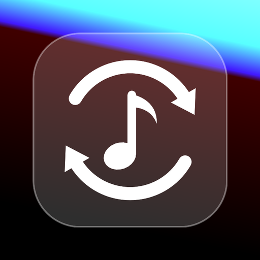
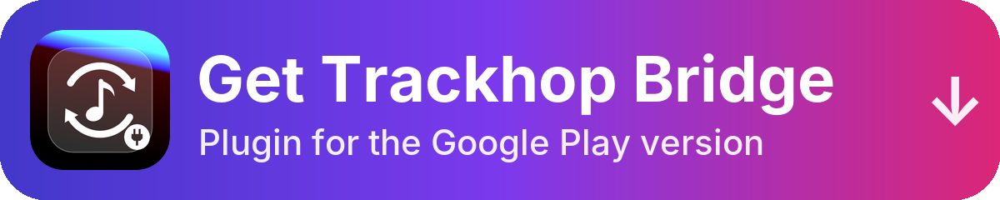
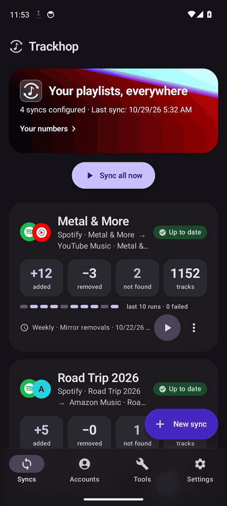
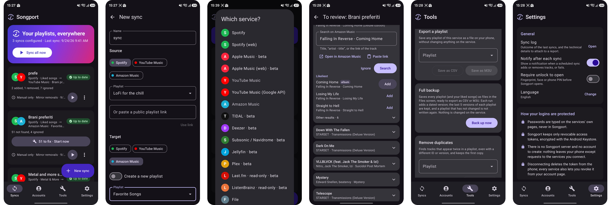

<p align="center"></p>

<h1 align="center">Trackhop</h1>

<p align="center"><b>Your playlists, in sync across music services.</b><br>
On your phone, on a schedule. No account, no server, no subscription.</p>

<p align="center">
  <a href="https://github.com/xlollx/Trackhop/releases/latest"></a>
  <a href="https://github.com/xlollx/Trackhop/releases"></a>
  <a href="LICENSE"></a>
  
  <a href="https://xlollx.github.io/Trackhop/guide/security"></a>
  <a href="https://xlollx.github.io/Trackhop/guide/security"></a>
</p>

> **Songport is now Trackhop.** Same app, same code, same updates. The name changed because an
> unrelated service called "SongPort", a music link converter, works in the same space, and two apps
> with one name confuse people. Your installed app updates normally and keeps all its data; only the
> name and the web addresses changed (github.com/xlollx/Trackhop, xlollx.github.io/Trackhop), and old
> links keep working.

<p align="center">
  <a href="https://f-droid.org/packages/com.xlollx.songport/"></a>
  <a href="https://apps.obtainium.imranr.dev/redirect?r=obtainium://add/https://github.com/xlollx/Trackhop"></a>
</p>

<p align="center">
  <b>Installed Trackhop from Google Play?</b> Add the plugin for YouTube Music, Amazon Music, and Spotify and Apple Music without developer keys:<br><br>
  <a href="https://github.com/xlollx/Trackhop-Bridge/releases/latest"></a>
</p>

<p align="center">
  <b>On a computer or a server?</b> <sub>(beta)</sub><br>
  <a href="https://github.com/xlollx/Trackhop/releases/download/server-v0.6.1/Trackhop-Desktop-v0.6.1-windows.msi"></a>
  <a href="https://xlollx.github.io/Trackhop/guide/desktop#macos"></a>
  <a href="https://github.com/xlollx/Trackhop/releases/download/server-v0.6.1/Trackhop-Desktop-v0.6.1-linux.deb"></a>
  <a href="https://xlollx.github.io/Trackhop/guide/docker"></a>
</p>

<p align="center"></p>

<p align="center"></p>

Trackhop keeps playlists identical across Spotify, Apple Music, YouTube Music, Amazon Music, TIDAL,
Deezer, Subsonic/Navidrome, Jellyfin and Plex, with Last.fm, ListenBrainz and public SoundCloud, NetEase
Cloud Music and QQ Music links as sources and playlist files (CSV, TSV, M3U, iTunes XML, JSON, pasted text) as a bridge to everything else. Everything runs
on the phone: there is no Trackhop server, and access tokens never leave the device. Free, no ads in
this build: development lives on voluntary donations.

**Why not an online transfer service?** Soundiiz, TuneMyMusic and FreeYourMusic are good at a one-off
move. Trackhop is for keeping playlists in step over time, without handing your accounts to anyone:

| | Trackhop | Online transfer services |
|---|---|---|
| Where it runs | On your phone | On their servers |
| Who holds your service logins | Only your phone, encrypted | The service |
| Account, subscription | None | Account; limits on the free plan |
| Scheduled sync, removals mirrored | Yes | Mostly paid plans |
| Personal servers (Navidrome, Jellyfin, Plex) | Yes | Rarely |
| Source code | Open (GPL-3.0-only) | Closed |

### Install

- **[F-Droid](https://f-droid.org/packages/com.xlollx.songport/)**: built from source, signed with the
  same key as the GitHub APK, so the two update each other.
- **[Obtainium](https://github.com/ImranR98/Obtainium)**: add `https://github.com/xlollx/Trackhop` and
  each release reaches the phone by itself.
- **[Releases](https://github.com/xlollx/Trackhop/releases/latest)**: the signed APK of every version.
- **Google Play version**: the same app limited to official APIs (store rules), with a small ad.
  Using it and want YouTube Music, Amazon Music, or Spotify and Apple Music without developer keys?
  Install the companion plugin **[Trackhop Bridge](https://github.com/xlollx/Trackhop-Bridge)**
  (GitHub only, read its notes first), or switch to the F-Droid/GitHub build above, which has them
  built in. [Which Trackhop?](https://xlollx.github.io/Trackhop/guide/versions) compares the two.
- **Desktop (Windows, macOS, Linux, beta)**: works for everyday use, still young. The same engine as a program on your
  computer, with its own Java runtime (no Java or Docker to install, no administrator rights), an icon
  next to the clock and the same web page as the server. Version 0.6.1 ([what's in it](https://github.com/xlollx/Trackhop/releases/tag/server-v0.6.1)):
  [Windows installer](https://github.com/xlollx/Trackhop/releases/download/server-v0.6.1/Trackhop-Desktop-v0.6.1-windows.msi) ·
  [Windows, no install (.zip)](https://github.com/xlollx/Trackhop/releases/download/server-v0.6.1/Trackhop-Desktop-v0.6.1-windows.zip) ·
  [macOS, Apple silicon](https://github.com/xlollx/Trackhop/releases/download/server-v0.6.1/Trackhop-Desktop-v0.6.1-macos-arm64.dmg) ·
  [macOS, Intel](https://github.com/xlollx/Trackhop/releases/download/server-v0.6.1/Trackhop-Desktop-v0.6.1-macos-x64.dmg) ·
  [Linux .deb](https://github.com/xlollx/Trackhop/releases/download/server-v0.6.1/Trackhop-Desktop-v0.6.1-linux.deb) ·
  [Linux .tar.gz](https://github.com/xlollx/Trackhop/releases/download/server-v0.6.1/Trackhop-Desktop-v0.6.1-linux.tar.gz) ·
  [Linux Flatpak](https://github.com/xlollx/Trackhop/releases/download/server-v0.6.1/Trackhop-Desktop-v0.6.1-linux.flatpak). See the
  [Desktop guide](https://xlollx.github.io/Trackhop/guide/desktop); every version is in the
  [Desktop & Server releases](https://github.com/xlollx/Trackhop/releases?q=server-v&expanded=true) (`server-v…`).
  With [Scoop](https://github.com/xlollx/scoop-bucket): `scoop bucket add xlollx https://github.com/xlollx/scoop-bucket`
  then `scoop install xlollx/trackhop`; with [Homebrew](https://github.com/xlollx/homebrew-tap) on a Mac:
  `brew install --cask xlollx/tap/trackhop`. The Mac app is not signed by Apple: the first time,
  *System Settings › Privacy & Security › Open Anyway* ([how](https://xlollx.github.io/Trackhop/guide/desktop#macos)). *Coming soon, not live yet:* `winget install xlollx.Trackhop`,
  `choco install trackhop` (both in review), the Microsoft Store, and
  `flatpak install flathub io.github.xlollx.Trackhop` ([packaging/](packaging/README.md)).
- **Server (Docker, beta)**: works for everyday use, still young. The same engine on a home server or a NAS, with a web page and
  scheduled syncs: `docker run -p 8080:8080 -v trackhop-data:/data ghcr.io/xlollx/trackhop`. Official
  APIs, personal servers and YouTube Music with pasted cookies (unofficial); see the
  [Docker guide](https://xlollx.github.io/Trackhop/guide/docker). To update: `docker pull ghcr.io/xlollx/trackhop`,
  then remove and start the container again (the data stays in its volume). The same image is also on
  [Docker Hub](https://hub.docker.com/r/xlollx/trackhop): `docker pull xlollx/trackhop`. For the whole
  household, `SONGPORT_MULTIUSER=true`: each person signs in and has their own services and syncs
  ([how](https://xlollx.github.io/Trackhop/guide/docker#several-people-on-one-server)).
- Desktop and Docker also have **radio syncs**: Trackhop listens to an internet radio in the hours
  you choose and saves the songs it plays to a playlist on any service
  ([how](https://xlollx.github.io/Trackhop/guide/docker#radio-syncs)), and **Shazam syncs**, like the
  app's ([how](https://xlollx.github.io/Trackhop/guide/shazam)).
- Desktop and Docker also have a **REST API and a webhook**, for Home Assistant, n8n, Node-RED or a
  script: list and start syncs, read their results, add and remove tracks in any connected
  service's playlists, get notified when a run ends. See
  [Automation: REST API and webhook](#automation-rest-api-and-webhook).
- And a **command line**, `trackhop`: `trackhop run --all --wait`, `trackhop add spotify Focus "Bonobo - Kerala"`,
  from a terminal, cron or Task Scheduler, with nothing to set up on the same machine or in the
  container (`docker exec trackhop trackhop syncs`). See [the trackhop command](https://xlollx.github.io/Trackhop/guide/cli).
- Desktop and Docker have their **own version** (now 0.6.1), separate from the app's.

Android 8.0 or newer. Languages: English, Italian, French, German, Spanish, Portuguese (Brazil), Polish,
Russian, Turkish, Chinese, Japanese, Korean.
New here? The **[guide](https://xlollx.github.io/Trackhop/guide/)** covers getting started and the
common errors.

### Good to know

- Apple Music, TIDAL, Deezer, SoundCloud, the personal servers, Last.fm and ListenBrainz are marked **beta** in
  the app: written against each service's documented API and working, but with far less real-world
  use than the rest, so a report about them is especially welcome.
- Deezer (web) is marked **alpha**: covered by offline tests but not yet tried on real accounts. Try
  it on a test playlist first and report what goes wrong. SoundCloud with your account is **beta**.
- The app ships without service credentials of its own: on the services that require one (Spotify,
  YouTube Music, TIDAL, Deezer, Last.fm) each user creates a free developer key, and the app walks
  them through it in about two minutes. Or use the quick route: sign in on the service's own page.
  Personal servers and files need nothing.
- License: GPL-3.0-only, see [LICENSE](LICENSE). Security reports: [SECURITY.md](SECURITY.md).

---

## Public beta

Trackhop is in **open beta**: the features are complete and used daily by the developer, and now
they need other libraries, phones and habits. Everything you meet is meant to work; if it does not,
that is exactly what to report.

- **Install**: the signed APK from the [Releases](https://github.com/xlollx/Trackhop/releases/latest)
  page (updates install over it), or F-Droid once listed there. This build includes YouTube Music,
  Amazon Music and the Spotify/Apple Music web sign-in; no second app is needed.
- **What helps most**: the connectors marked *beta* in Accounts, a sync of a big playlist (a thousand tracks and more), the review of the tracks
  that were not found (one-tap proposals, the "likeliest" list, pasting a track link), scheduled syncs
  surviving the night, and backups of a whole account.
- **How to report**: open an [issue](https://github.com/xlollx/Trackhop/issues/new/choose) and attach
  the **technical details report** (Settings → *Sync log* → *Share technical details*): versions, connectors, the
  last sync steps and plugin statistics, never tokens or track lists. Italian is welcome.
- **Known rough edges**: see [Known limits](#known-limits). Matching depends on each catalogue's search:
  a track "not found" is usually missing or titled differently on the destination, and the review
  screen exists for those.

---

## Contents
- [Public beta](#public-beta)
- [Features](#features)
- [Supported services and their limits](#supported-services-and-their-limits)
- [Connector plugins](#connector-plugins)
- [Automation: REST API and webhook](#automation-rest-api-and-webhook) (Desktop and Docker)
- [How tracks are matched](#how-tracks-are-matched)
- [How logins are protected](#how-logins-are-protected)
- [Architecture](#architecture)
- [Project layout](#project-layout)
- [Building](#building)
- [API configuration](#api-configuration)
- [Ads, consent and donations](#ads-consent-and-donations)
- [Publishing on Google Play](#publishing-on-google-play)
- [Contributing](#contributing)
- [License, copyright and trademark](#license-copyright-and-trademark)
- [Known limits](#known-limits)

---

## Features

| Area | Feature | Notes |
|------|---------|-------|
| Sync | Source → target between any two services | Same service too (playlist copy). |
| | Existing playlist or automatic creation of the target | Created playlists are private. |
| | Manual ("Run", "Sync all") | Manual syncs run as a foreground job with a progress notification. |
| | Scheduled: hourly, every 6 hours, daily, weekly | WorkManager, survives reboots; "Wi-Fi only" option. |
| | Additions only (default) or mirror removals | Removals are skipped when the source comes back empty. |
| | Bidirectional | One switch creates the reverse twin sync without removals; the two are deleted together. |
| | Keep the source order | After the adds, the target is put in the source's order; Spotify (both routes), YouTube Music and Deezer can move tracks. |
| | "Liked songs" as source or target | Spotify, Deezer, Subsonic, Jellyfin, Last.fm, ListenBrainz. |
| | Shazam sync | Every song you Shazam, in a playlist of your choice on any service. Shazam has no API for your library, so nothing unofficial is used: in Shazam's settings, connect Spotify or Apple Music and Shazam keeps every Shazam in a "My Shazam Tracks" playlist there; "Shazam" as the source in the editor finds that playlist on your connected account (or says how to turn it on) and syncs it hourly. The card wears Shazam's mark. Also on Desktop and Docker (Spotify). [Guide](https://xlollx.github.io/Trackhop/guide/shazam). |
| | Radio sync | The songs an internet radio plays in the hours you choose (days, from, to; past midnight too), in a playlist on any service. Find the station by name in radio-browser.info or paste its stream; only the song title the station sends with its stream is read, never the audio, and adverts, news and the station's name are left out. On the phone the stream is sampled every 2 minutes (a few seconds each, a few MB an hour), on Wi‑Fi by default, from a quiet "Listening to …" notification; the songs are synced every 10 minutes and when the window closes. The card wears a radio and says what is on air. Also on Desktop and Docker. [Guide](https://xlollx.github.io/Trackhop/guide/radio). |
| | Saved albums, followed artists, podcasts | Sync or transfer them like a playlist (Spotify, Deezer, Subsonic/Navidrome, Jellyfin; Apple Music albums, add only). Matched by UPC where available, then title and artist; the review works the same. YouTube Music and TIDAL not yet. |
| Preview | What would change, before doing it | Already present, to add, to remove, not found, uncertain. |
| Matching | Rules per sync | Strictness, explicit or clean preference, same album, studio versions only. |
| | ISRC, then title + artist + duration | Match cache; penalises live, karaoke, cover and sped-up versions when the original is not one. |
| Review | Uncertain matches to confirm | Below 86% similarity a match is accepted but flagged; confirm or replace it. |
| Not found | Manual fix | Free search on the target, pick the result, or "ignore". Tracks the service has no trace of are marked so and listed last. |
| Restore | Put back tracks removed by a mirror sync | From the log. |
| YouTube quota | Ring with the units used today | Search 100, write 50 out of 10,000 per day; the app shows what is left and what a sync will cost. |
| Multiple accounts | Several accounts of the same service | Also for migrating between two accounts. |
| Tools | Playlist generator (beta) | Describe a playlist; your own AI (OpenAI, Anthropic, Gemini or any OpenAI-compatible server, even local) proposes the tracks, Trackhop finds them on the chosen service through a normal sync. The proposal is reviewed before anything is created, the sync is marked with a spark and can be extended later with more AI picks. No AI of Trackhop's: your key, stored encrypted; only the text you type is sent. |
| | Manage playlists | Your playlists on a service in one list: rename, delete, make public or private (where the API allows it), search the tracks and remove them by track, artist or album, extend with AI, export. |
| | Batch transfer | Pick many playlists of one service and send them all to another: one sync each, run one after the other, kept in Syncs. |
| | Playlist tools | Copy, merge (skipping duplicates), split into parts, sort by artist/title/album/year/date added/duration, shuffle; always into a new playlist, the originals untouched. |
| | Repeats across playlists | Tracks in more than one playlist and liked songs in no playlist, per service; each list can become a file. |
| | Backup to a folder | The dated backups also copied to a folder you pick (SD card, Nextcloud, Drive…), daily or weekly. |
| | Full backup of a service | Playlists and likes into local files, with dated versions. |
| | Duplicate removal | Same track even with a different id or version; keeps the first copy. |
| | "How compatible are we?" | Two playlists, from any services or public links: tracks in common, shared artists, a 0–100 score and "for you" picks, as a shareable card (story or square). Share two playlist links at once to open it. |
| | Playlist poster | Covers (four different albums), title, numbers and a QR code that opens the playlist on its service, as a card to share or save. The QR is made on the phone. Optional: a cover drawn by your own AI (OpenAI or Gemini, or an OpenAI-compatible server with an image model), on your key; only the title, the main artists and the description are sent. |
| | Unplayable tracks | The tracks a service lists but can no longer play (greyed out: pulled from the catalogue, not licensed in your country): found across your playlists, each with a playable version proposed by the same matching the sync uses (ISRC, then title, artist, duration), to accept, change, remove or skip; put back in the dead entry's spot where the service can move tracks; undoable. Spotify, Deezer, TIDAL, Apple Music library, YouTube, YouTube Music. An optional weekly check notifies, never changes anything. |
| Links | Paste or share a public playlist link | Spotify, Apple Music, YouTube, Deezer, TIDAL; short share links too. "From link" is a source of its own in the editor. |
| | Share a single track or a text list | A track link from any music app goes into one of your playlists on **any** connected service, Navidrome, Jellyfin and Plex included: the same recording is found with the sync's matching, shown with its score before adding, with "Open in…" and "Copy link" next to it. Several "Artist - Title" lines become a file playlist and a new sync. |
| | Music links open with Trackhop (optional) | Settings › "Offer Trackhop for music links": Android then lists Trackhop among the apps for a Spotify, Apple Music, YouTube Music, Amazon Music, Deezer or TIDAL link. Off by default; Trackhop never takes a link by itself. |
| Files | Import/export | Reads CSV, TSV, M3U/M3U8, XSPF, JSPF, OPML (podcasts), Apple Music/iTunes XML, JSON, Shazam exports, plain text lists; writes CSV, M3U, XSPF, JSPF and plain text. |
| | setlist.fm | Share or paste a setlist.fm link: the concert becomes a playlist to sync anywhere. |
| | Shazam | Share a song from the Shazam app: title and artist are read from the shared text (nothing is asked of Shazam) and the song goes into a playlist on any connected service. To have every Shazam everywhere, make a Shazam sync (above): "Sync my Shazams" in the sheet opens one. |
| Widget and shortcuts | Home widget and long-press on the icon | Last sync, "Sync all", "New sync". |
| Diagnostics | "Share technical details" in the log | Version, device, services, last runs, error log; no tokens. |
| | "Test the connection" per account | Account, playlist list and one search, with the service's answer on failure. |
| Appearance | Theme and Material You | Settings › Appearance: system, light or dark; "Dynamic colours" takes the phone's wallpaper palette (Android 12+) instead of the brand's, off by default. |
| Security | Connections log | Settings › Developer options lists every host the app has contacted and how often, so "no Trackhop server" is something to check, not to believe. |
| | Info sheet before every login, encrypted tokens, fingerprint or PIN lock | See [How logins are protected](#how-logins-are-protected). |

## Supported services and their limits

| Service | Status | Login | What the build needs | Limits |
|---------|--------|-------|----------------------|--------|
| Spotify | complete | OAuth PKCE on Spotify's sign-in page, shown inside the app (a browser tab handed "Continue with Facebook" to the Facebook app, which then failed) | `SPOTIFY_CLIENT_ID`, redirect `songport://callback` | An app in *Development Mode* accepts 5 users and its owner needs Spotify Premium (February 2026 rules). *Extended Quota Mode* requires a registered company and 250,000 monthly active users. Since July 2026 the quota is counted per developer account, not per client ID. That is why the app walks each user through creating their own client ID: on Spotify this is the normal path. |
| Apple Music | read and add, beta | MusicKit JS in an in-app WebView | `APPLE_DEVELOPER_TOKEN` (ES256 JWT, Apple Developer Program) | The API cannot remove tracks from a playlist: mirror syncs towards Apple Music only add and say so in the report. The developer token expires after at most 6 months. An Apple Music subscription is required. Library tracks do not expose an ISRC. |
| YouTube Music | built into the GitHub/F-Droid build; in the Play build via the [Trackhop Bridge](https://github.com/xlollx/Trackhop-Bridge) | Google sign-in on Google's page | nothing: the Bridge is installed separately, outside Google Play | Uses the web player's internal interface: not an official API, against the YouTube Terms of Service, may break without notice. No quota. The Bridge shows the notice before sign-in. |
| YouTube Music (Google API) | via YouTube Data API v3 | Google OAuth | `GOOGLE_CLIENT_ID` (Android OAuth client: package + SHA-1), YouTube Data API enabled, OAuth verification for the `youtube` scope | 10,000 units per day per project (search 100, insert 50), shared by every user of the same build. With own credentials the quota is the user's. No ISRC. |
| Spotify (web) | complete, built in (GitHub/F-Droid) or via the [Trackhop Bridge](https://github.com/xlollx/Trackhop-Bridge) | Spotify sign-in on Spotify's page | nothing, and no Premium | Talks to the web player's own backend (the GraphQL gateway and the playlist store open.spotify.com uses), with the player's session token and client token; the query hashes are read from the player's own code. Since December 2025 Spotify refuses first-party tokens on the public Web API, which is why this route no longer touches it. No ISRC on this route: matching is by title, artist and duration. Not an official route, against Spotify's terms, may break without notice. |
| Apple Music (web) | read and add, built in (GitHub/F-Droid) or via the Trackhop Bridge | Apple ID sign-in on Apple's page | nothing | The Bridge reads the web player's developer token and the music user token cookie; Trackhop then runs the same Apple Music code as above. Not an official route, against Apple's terms, may break without notice. |
| Amazon Music | complete, built in (GitHub/F-Droid) or via the [Trackhop Bridge](https://github.com/xlollx/Trackhop-Bridge) | Amazon sign-in on Amazon's page | nothing | Amazon's official Web API is a closed beta for approved partners, so the Bridge uses the web player's interface (library playlists, playlist rows with their entry ids, search, create, add, remove, rename, delete). Not an official API, may break without notice. |
| TIDAL | beta | OAuth PKCE | `TIDAL_CLIENT_ID` | API v2 (JSON:API) still evolving; endpoints isolated in `TidalProvider.kt`. Beta: limited real-world use. |
| Deezer | beta | OAuth implicit | `DEEZER_APP_ID` and an https redirect page (`docs/deezer-redirect.html`) | Registration of new apps may be closed. Playlists read from Deezer carry no ISRC. Beta: limited real-world use. |
| Subsonic / Navidrome (Airsonic, Gonic, Ampache, LMS, Funkwhale) | complete, beta | server URL, user, password (md5+salt token) | nothing | Starred tracks = likes. Ampache checks the token against the separate *Subsonic password* (or the API key) from *Preferences → Account*, not the account password; the app says so when Ampache refuses the login. |
| Jellyfin | complete, beta | server URL, user, password | nothing | Favourites supported. |
| Plex | complete, beta | server URL and X-Plex-Token | nothing | Music playlists only. A new playlist is created empty on the server's library, then filled (checked on Plex 1.43). |
| Last.fm | read-only, beta | username | `LASTFM_API_KEY` or a key entered by the user | Loved tracks only, source only. |
| ListenBrainz | read-only, beta | username | nothing | Playlists and loved tracks, source only. |
| Files | complete | | | Import/export through the system file picker, or "Paste a list". |
| SoundCloud | public links, read-only, unofficial; GitHub/F-Droid build and server only | none: paste a public set or likes link | nothing | No public API for new apps, so the link is read the way soundcloud.com's web player reads it, with the client id the site ships in its scripts. Sets (playlists, albums, EPs, unlisted ones with their secret link) and a user's public likes page; nothing to sign in to, never a destination. ISRC and album only where the uploader filled in the label metadata; otherwise "Artist - Title" is split from the title. Not an official route, may break without notice: the app then says it needs an update. |
| NetEase Cloud Music, QQ Music | public links, read-only, unofficial; GitHub/F-Droid build, Docker and Desktop from the site only | none: paste a public playlist link | nothing | No interface for third-party apps, so a public playlist is read the way the sites' own pages read it, with no account: title, artists, album and duration, no ISRC. Never a destination, never a sign-in. Not an official route, may break without notice: the app then says it needs an update. [More](https://xlollx.github.io/Trackhop/guide/netease-qq-music). |
| Qobuz, Pandora | not connectable | | | Partner-only or closed-beta APIs. Use files. |

Own credentials are entered from *Accounts → service card → Use your own credentials*: numbered
steps, link to the developer portal, redirect URI to copy, verification with a real login.

Google/YouTube: an *Android* OAuth client is tied to the APK signature, so the user cannot override
it. With own credentials the app switches to the *installed app* flow: a *Desktop* client and a
redirect to `http://127.0.0.1:<port>`, where the app listens on loopback only for the duration of the
authorisation (`auth/LoopbackServer.kt`).

Apple Music works without a backend because Apple provides MusicKit JS: the app opens a WebView on a
page served from its own assets (a real https origin through `WebViewAssetLoader`), MusicKit handles
the Apple ID sign-in and returns the *music user token*. Amazon Music has no open equivalent, which is
why it is offered through a connector plugin.

## Connector plugins

Some services have no open API, and on others the official route is heavy for a single user: a
developer account to register, a paid program, a daily quota to share. For those, Trackhop defines an
**open connector interface**: a separate app, a *plugin*, holds the sign-in to a service and answers
Trackhop's requests for playlists and tracks.

The Google Play build never includes, downloads or installs a plugin. It discovers one that the user
has already installed and then offers its services in the account picker, next to the official
routes, which stay available and unchanged. The GitHub and F-Droid build carries the reference
plugin's connectors inside instead (see below), so it needs no second app.

### How discovery works

A plugin declares an activity handling the intent action `com.xlollx.songport.action.CONNECTOR`, with
a `<meta-data>` entry named `com.xlollx.songport.connector.authority` holding the authority of its
`ContentProvider`. Trackhop queries that action (`providers/BridgePlugin.kt`), then calls the provider
with `ContentResolver.call()`; each provider in `providers/*BridgeProvider.kt` maps those calls onto
the usual `MusicProvider` interface, so the sync engine treats a plugin service like any other. The
plugin must verify the caller's package name and signing certificate before answering.

### Trackhop Bridge and the built-in web connectors

[**Trackhop Bridge**](https://github.com/xlollx/Trackhop-Bridge) is the reference plugin, by the
same author, free and open source (GPL-3.0-only), distributed on GitHub only and never on Google Play.
Its connectors are also built into Trackhop's GitHub and F-Droid build, as the `:bridge` library module
(`android/bridge`, included with `fullImplementation`): the same code runs inside Trackhop, called
in-process through `BridgeCore` instead of a ContentProvider (`providers/BuiltIn.kt` in `src/full`,
an empty twin in `src/play`). The separate Bridge app stays for the Play build. The connectors add:

| Service | What it adds |
|---------|--------------|
| YouTube Music | playlists, liked songs, search and writing without a Google Cloud project and without quota |
| Amazon Music | the only way to connect it: Amazon's Web API is a closed beta for approved partners |
| Spotify | sign-in without registering a developer app |
| Apple Music | sign-in without the Apple Developer Program |

It works by using the same web interfaces the services' own players use. That is against those
services' terms of use, it can stop working whenever a service changes something, and in the worst
case a service could restrict the account signed in. A disclaimer asks for acceptance before the
first sign-in, in the Bridge and in the built-in connectors alike. Passwords are typed only on the
services' own pages and are never seen or stored; the session cookies stay encrypted on the phone,
and the sync engine gets only data or short-lived tokens.

User-facing page: [xlollx.github.io/Trackhop/plugins](https://xlollx.github.io/Trackhop/plugins).

### Two distributions of Trackhop

The `play` flavor, the one for Google Play, never names, links to or describes any plugin; plugin
services appear only when a plugin is already installed, with generic wording, and it contains no
code that uses unofficial interfaces. The `full` flavor, the APK on GitHub Releases and on F-Droid,
has the web connectors built in and no ads. See
[Publishing on Google Play](#publishing-on-google-play).

## Automation: REST API and webhook

Trackhop Desktop and the Docker server expose a REST API, so other tools (Home Assistant, n8n,
Node-RED, a cron script) can list the syncs, start them and read how they went, and work on the
playlists of every connected service: create them, add tracks by title and artist or by a link
from any service (matched as a sync matches them), remove tracks, rename and delete. The Android
app has none: it has no server to answer.

Turn it on in **Tools › API** on the web page: make a token (shown once, only its SHA-256 hash is
stored) and send it as `Authorization: Bearer <token>`. It is separate from the page's password.
On Trackhop Desktop only the computer itself can reach it (loopback only).

| Call | What it does |
|---|---|
| `GET /api/v1/status` | Version, number of syncs, the ones running, the last run's time |
| `GET /api/v1/syncs` | Every sync: source, target, schedule, running, last result |
| `GET /api/v1/syncs/<id>` | One sync and its last 20 runs |
| `POST /api/v1/syncs/<id>/run` | Starts it (202 Accepted) |
| `POST /api/v1/syncs/run-all` | Starts every enabled sync |
| `GET /api/v1/runs/<id>` | A run: added, removed, not found, with the tracks |
| `GET /api/v1/services` | The services and whether they are connected |
| `GET /api/v1/files`, `GET /api/v1/files/<name>.csv?format=m3u` | The File playlists, in any export format |
| `POST /api/v1/files/<name>` | Adds a playlist file sent as the body (CSV, M3U, XSPF, JSPF, iTunes XML, JSON or text), ready to sync (201) |
| `POST /api/v1/syncs/<id>/enable`, `…/disable` | Turns a sync on or off |
| `GET /api/v1/backup`, `POST /api/v1/backup` | The last full backup and its schedule; starts one (202, with a task id) |
| `GET /api/v1/tasks/<id>` | A background task (a backup): progress, done, error |
| `GET /api/v1/config` (`?history=true`) | The whole set-up as a `.trackhop` file, as *Tools › Backup & restore* saves it |
| `GET /api/v1/metrics` | Prometheus metrics: syncs, running, and per sync the last run's time, result, added, removed and not found |
| `GET /api/v1/services/<service>/playlists` | A connected service's playlists (and its liked songs, saved albums… where it has them) |
| `POST /api/v1/services/<service>/playlists` | Creates a playlist: `{"name": "…"}` (201, with its id) |
| `GET /api/v1/services/<service>/playlists/<id>/tracks` | The playlist's tracks: id, title, artists, album, duration, ISRC |
| `POST /api/v1/services/<service>/playlists/<id>/tracks` | Adds tracks, searched and matched as a sync does: `{"tracks": [{"title": "…", "artist": "…"}, {"link": "https://open.spotify.com/track/…"}, {"id": "…"}, "Artist - Title"]}`. Tracks already there are skipped (`"allowDuplicates": true` to add them anyway); the answer lists what was added, already there and not found |
| `DELETE /api/v1/services/<service>/playlists/<id>/tracks` | Removes tracks named by id, or by title and artist matched against the playlist (`POST …/tracks/remove` does the same, for tools that cannot send a body with DELETE) |
| `PATCH`, `DELETE /api/v1/services/<service>/playlists/<id>` | Renames (`{"name": "…"}`) or deletes a playlist, where the service allows it |
| `GET /health` | `ok`, with no token: for Docker's health check, Uptime Kuma or a reverse proxy |

```sh
curl -H "Authorization: Bearer $TOKEN" http://127.0.0.1:8080/api/v1/syncs
curl -X POST -H "Authorization: Bearer $TOKEN" http://127.0.0.1:8080/api/v1/syncs/run-all
```

**Webhook.** With an address set in *Tools › API*, every finished run is POSTed there as JSON
(`"event": "sync.finished"`, the sync, and the run with its added and not-found tracks), and every
full backup as `"event": "backup.finished"`. With a secret, the `X-Trackhop-Signature: sha256=<hex>` header is the HMAC-SHA256 of the body, to check
that the call came from your Trackhop. Example: a Home Assistant *Webhook* trigger that sends a
notification when tracks were not found, and a `rest_command` that starts every sync.

**Grafana.** Point Prometheus at `/api/v1/metrics` with the token as `bearer_token` to chart what
every sync adds and misses, and alert when one fails.

Details and more examples: [Docker guide › API](https://xlollx.github.io/Trackhop/guide/docker#api).

## How tracks are matched

`sync/Matcher.kt` is plain Kotlin and covered by tests:

1. Identical ISRC → same track (score 1.0). Spotify, TIDAL and Deezer expose it.
2. Otherwise the normalised title (lowercase, no accents, without `(feat. …)`, `- Remastered 2011`,
   `[Official Video]`; "remix" is kept) is compared with Levenshtein and token Jaccard; artists are
   compared with each other; duration is a factor (±3 s full, beyond 25 s strong penalty).
   Threshold 0.70 for search results, 0.82 to recognise tracks already in the target, 0.86 below
   which a match is flagged as uncertain.
3. YouTube video titles are split into artist/title (`sync/TitleParser.kt`).
4. Every match goes into a local cache (`Store.matchCache`, up to 20,000 entries).

## How logins are protected

- The password is typed on the service's own site (Custom Tab with a visible address bar) or in
  Apple's official window. Personal server credentials stay on the phone.
- The app only receives a revocable token, encrypted with `EncryptedSharedPreferences` (key in the
  Android Keystore) and excluded from backups. Disconnecting deletes it; every card links to the
  service's revocation page.
- No intermediate server: requests go from the phone to the connected services.
- Before every "Connect" a sheet shows the domain that will open and what the app receives.
- Optional fingerprint, face or PIN lock on launch (`BiometricPrompt`).
- No key or secret in the repository: client IDs, developer token, AdMob IDs and signing keys come
  from the build (GitHub Actions variables and secrets).

## Architecture

```
MainActivity (tabs: Syncs, Accounts, Tools, Log, Settings)                      AdBanner (AdMob + UMP)
    │
    ├── SyncEditor / Preview / Review ──▶ Store (store.json: jobs, reports, match cache, settings)
    │
    └── Scheduler (WorkManager: periodic per job, one-shot "run now") ──▶ SyncWorker ──▶ SyncEngine
                                                                                        │
                                                       MusicProvider (interface, one instance per account)
                                                       Spotify · AppleMusic · YouTube · Tidal · Deezer
                                                       Subsonic · Jellyfin · Plex · LastFm · ListenBrainz · SoundCloud · Netease · QqMusic · LocalFiles
                                                                                        │
AuthFlow (PKCE, loopback) · AppleAuthActivity (MusicKit JS) · ServerLoginActivity · TokenStore (encrypted)
                                                                                        ▼
                                             Official service APIs, called directly from the phone
```

## Project layout

```
Trackhop/
├── README.md, LICENSE, SECURITY.md
├── docs/
│   ├── privacy-policy.md          # privacy policy (EN + IT) to publish and link in the Play listing
│   ├── play-store-listing.md      # store texts, Data safety answers, release checklist
│   ├── deezer-redirect.html       # https page → songport://callback
│   ├── google-shared-client.md    # shipping a shared Google client: verification and quota
│   ├── guide/                     # the guide on the site (getting started, troubleshooting, Docker…)
│   └── store/                     # 512×512 icon and 1024×500 feature graphic (en/it)
├── server/                        # Trackhop on a server and on the desktop: JVM build on android/core and android/ytm, web page, Dockerfile, desktop/ (packaging)
├── packaging/                     # Desktop and Docker for winget, Chocolatey, Scoop, the Microsoft Store (MSIX), Flathub, Docker Hub
└── android/
    ├── build.gradle, settings.gradle, gradle.properties
    ├── core/                      # the engine without Android (model, matching, connectors, sync), shared with server/
    ├── ytm/                       # the YouTube Music web client without Android, shared by bridge/ and server/
    ├── bridge/                    # the built-in web connectors (GitHub/F-Droid build): WebView sign-ins and players
    └── app/
        ├── build.gradle           # build parameters: client IDs, AdMob, release signing from env/secrets
        ├── proguard-rules.pro
        └── src/
            ├── main/AndroidManifest.xml
            ├── main/java/com/xlollx/songport/
            │   ├── MainActivity.kt, SongportApp.kt, Notifications.kt
            │   ├── ai/AiClient.kt             # Playlist generator: the user's own AI provider (OpenAI-compatible, Anthropic, Gemini)
            │   ├── ads/Ads.kt                 # UMP consent + adaptive banner
            │   ├── auth/                      # Pkce, AuthFlow, AuthCallbackActivity, AppleAuthActivity, LoopbackServer, ServerLoginActivity, LockActivity
            │   ├── data/                      # Store (JSON, coalesced writes), TokenStore (encrypted), Diagnostics
            │   ├── model/Models.kt            # Track, Playlist, SyncJob, SyncReport, SyncPlan
            │   ├── net/                       # Http (OkHttp, 429 retry), JSON helpers
            │   ├── providers/                 # MusicProvider and its implementations
            │   ├── sync/                      # Matcher, Duplicates, TitleParser, CsvCodec, PlaylistFiles, PlaylistLinks, SyncEngine, Tools, Scheduler, QuotaMeter
            │   ├── ui/                        # Compose screens and shared components (Common.kt, Theme.kt)
            │   └── widget/SyncWidget.kt
            ├── main/assets/applemusic/auth.html  # MusicKit JS page for the Apple Music login
            ├── main/res/values(-it,-fr,-de,-es,-zh,-ja)/strings.xml
            └── test/…/sync/                   # JUnit tests (matcher, parsers, CSV, links)
```

## Building

Requirements: JDK 17, Android SDK with platform 36. From `android/`:

```bash
./gradlew testFullDebugUnitTest   # unit tests (plain Kotlin, no emulator)
./gradlew assembleFullDebug       # GitHub build, APK in app/build/outputs/apk/full/debug/
./gradlew assemblePlayDebug       # Google Play build, with the ads SDK
```

Or open `android/` in Android Studio. Without build variables the OAuth services show as
"Not configured" and can be used with own credentials entered in the app; files and personal servers
always work.

Toolchain: AGP 8.11.1, Gradle 8.14.3, Kotlin 2.1.21, compileSdk/targetSdk 36, minSdk 26.

### GitHub Actions

`.github/workflows/build.yml` runs on every push to `main`, on pull requests and manually. It runs the
tests, builds the debug APK and, when the upload key secrets are present, the signed AAB and APK. A
push to `main` whose `versionName` in `app/build.gradle` has no tag yet creates the tag and publishes
both as a GitHub Release: to release, bump `versionCode` and `versionName` and push. With the
`DEBUG_KEYSTORE_BASE64` secret (a debug keystore in base64) the debug APK keeps the same signature
across builds so updates install over each other; the file itself is not in the repository.

## API configuration

By default the build contains no service credentials. In the app, a service without a key shows a
**Set up** button that opens a guided wizard: why the key is needed, a link to the developer portal,
the redirect URI to copy, the field to paste the key, and a real login to verify it. This is the
intended distribution model: every user stays within their own quota and the project never holds a
shared key.

- Spotify: a client ID created on developer.spotify.com (the user needs Spotify Premium, a Spotify rule).
- YouTube Music: either the optional Bridge app (no key at all; its repository explains what it is
  and what it risks) or, on the "YouTube Music (Google API)" card, a *Desktop* OAuth client from a
  Google Cloud project with YouTube Data API v3 enabled (client ID and secret); the app then uses
  the loopback flow.
- TIDAL: a client ID from developer.tidal.com.
- Deezer: an application ID from developers.deezer.com; the https redirect page is provided by the
  project (`docs/deezer-redirect.html`, published on GitHub Pages) and prefilled.
- Last.fm: a free API key.
- Apple Music: a MusicKit developer token, which requires the paid Apple Developer Program.

A maintainer who wants to ship shared credentials can set the build variables below; for Google
the full procedure (Android client, verification, quota) is in `docs/google-shared-client.md`. Set them
(*Settings → Secrets and variables → Actions*). Users can still override them in the app.

| Variable | Where to get it | Redirect URI to register |
|----------|-----------------|--------------------------|
| `SPOTIFY_CLIENT_ID` | developer.spotify.com → Dashboard → Create app (Web API) | `songport://callback` |
| `GOOGLE_CLIENT_ID` | console.cloud.google.com → Credentials → Android OAuth client (package `com.xlollx.songport` + SHA-1 of the release signature). Enable YouTube Data API v3, configure the consent screen, request verification for the `youtube` scope. | automatic (`com.googleusercontent.apps.<id>` scheme) |
| `APPLE_DEVELOPER_TOKEN` (secret) | Apple Developer → Keys → MusicKit → `.p8` key, Key ID and Team ID, then the JWT below | none |
| `TIDAL_CLIENT_ID` | developer.tidal.com → Dashboard → Create app | `songport://callback` |
| `DEEZER_APP_ID`, `DEEZER_REDIRECT_URL` | developers.deezer.com → My Apps. Publish `docs/deezer-redirect.html` on an https host and use that URL as redirect and "Application domain". | the https URL of the page |
| `LASTFM_API_KEY` | last.fm/api/account/create | none |
| `ADMOB_APP_ID`, `ADMOB_BANNER_ID` | AdMob | |
| `PRIVACY_POLICY_URL`, `KOFI_URL` | public URLs of the privacy policy and the donation page; an empty `KOFI_URL` hides the button | |

With a public repository, register only the SHA-1 of the upload key and of Play App Signing in the
Google OAuth client, never the debug one.

Generating the Apple Music developer token (expires after at most 6 months):

```bash
pip install pyjwt cryptography
python - <<'PY'
import jwt, time
KEY_ID, TEAM_ID, P8 = "ABCD123456", "TEAM123456", "AuthKey_ABCD123456.p8"
print(jwt.encode({"iss": TEAM_ID, "iat": int(time.time()), "exp": int(time.time()) + 15777000},
                 open(P8).read(), algorithm="ES256", headers={"kid": KEY_ID}))
PY
```

## Ads, consent and donations

- **The GitHub build (`full` flavor) has no ads and does not include the ads SDK.** AdMob serves ads
  only to apps listed on Google Play or the App Store; in a directly downloaded APK the SDK would bring
  only the consent form and Google's code. `src/full/.../ads/Ads.kt` is an empty twin of the real one,
  and the ads dependencies are `playImplementation`.
- The Play build (`play` flavor, `src/play/.../ads/Ads.kt`) shows one adaptive banner at the bottom of
  the main screen. No interstitials, videos or full-screen ads.
- Before loading ads the app asks for consent through Google UMP; without consent no ads are
  requested. *Settings* shows "Ad privacy options" where regulations require it.
- Release builds carry Trackhop's own AdMob ids (defaults in `app/build.gradle`; a fork sets its own
  through the `ADMOB_APP_ID` and `ADMOB_BANNER_ID` variables). Debug builds always use Google's test
  ids, whatever the variables say. Never test with real ids: list the developer's phones in
  `ADMOB_TEST_DEVICES` (comma-separated hashed ids, printed by the SDK in logcat on the first request,
  or register the phones in AdMob → Settings → Test devices) so they get test ads with the real units.
- Going live also needs, in AdMob: a **GDPR message** under *Privacy & messaging* for this app
  (without it European users get no consent form, so the app requests no ads for them), the app
  **linked to its Play listing** once published, and an **app-ads.txt** at the root of the developer
  website named in the listing (`https://<domain>/app-ads.txt`, one line:
  `google.com, pub-<publisher id>, DIRECT, f08c47fec0942fa0`). A GitHub Pages *project* site does not
  work for that, the file must be at the domain root, for instance a `<user>.github.io` repository.
- On first launch a card explains how the app is funded (the ads in the Play build, donations in the
  GitHub one) and offers a button to a donation page (Ko-fi). Donating is voluntary and unlocks
  nothing. *Settings* has the Ko-fi button and GitHub Sponsors (`KOFI_URL`, `SPONSORS_URL`), and the
  repository's *Sponsor* button (`.github/FUNDING.yml`) offers both.
- In the GitHub build only, the first successful sync that adds at least 100 tracks arms a one-time
  card on the Syncs screen ("You just moved 1,322 tracks") with a coffee button (`sync/SupportPrompt.kt`).
  Either answer closes it for good.
- Before publishing on Google Play, check its payments policy on links to external donation pages:
  if they are not allowed there, hide the donation buttons in the `play` flavor.

## Publishing on Google Play

### Two distributions: `play` and `full`

The app has two product flavors of the same code:

- **`play`** is what goes to Google Play. It never names, links to or describes any companion app.
  Services that rely on a *connector plugin* (an app installed separately that implements Trackhop's
  open connector interface, discovered through the intent action `com.xlollx.songport.action.CONNECTOR`)
  are offered only when such a plugin is already installed, with generic wording, and are otherwise
  absent from the service picker. Trackhop itself only ever calls official APIs and local files, so the
  Play review sees exactly that. The AAB in the CI artifacts and in every release (`Songport-vX-play.aab`)
  is this flavor: upload only that to the Play Console.
- **`full`** is the direct-download build on GitHub Releases (`Songport-vX.apk`). It can point to where a
  plugin is available and recognises older plugin versions by package name.

Keep the Play listing consistent with the `play` flavor: describe official-API services and file
import/export only; do not mention plugins or companion apps there.

Both flavors are called **Trackhop**, as are this repository, the site and the Docker image. Up to
version 1.1 the app was called Songport outside Google Play; the name changed because "SongPort" is
also an unrelated, active service in the same niche (songport.link). What existing installs and
setups depend on keeps the old name: the package id `com.xlollx.songport`, the `songport://callback`
redirect, the release asset names (`Songport-vX.apk`, which F-Droid's metadata matches), the Deezer
redirect page at `https://xlollx.github.io/Songport/deezer-redirect.html`, the server's `SONGPORT_*`
variables and the `ghcr.io/xlollx/songport` image, which is still published next to
`ghcr.io/xlollx/trackhop`.

1. Upload key (never in the repository):
   ```bash
   keytool -genkeypair -v -keystore upload.jks -alias upload -keyalg RSA -keysize 2048 -validity 10000
   base64 -w0 upload.jks   # value of the UPLOAD_KEYSTORE_BASE64 secret
   ```
   Secrets: `UPLOAD_KEYSTORE_BASE64`, `UPLOAD_KEYSTORE_PASSWORD`, `UPLOAD_KEY_ALIAS`, `UPLOAD_KEY_PASSWORD`.
   With Play App Signing, also register Play's SHA-1 in the Google OAuth client.
2. Variables: `ADMOB_APP_ID`, `ADMOB_BANNER_ID`, `PRIVACY_POLICY_URL`, `KOFI_URL`. Service client IDs are
   optional (see [API configuration](#api-configuration)).
3. Bump `versionCode` and `versionName` in `app/build.gradle` for every release.
4. Play Console: declare ads, fill in *Data safety* and the foreground service declaration
   (`dataSync` type, user-initiated); the policy is in `docs/privacy-policy.md`.
   Texts, answers, Data safety rows and the step-by-step checklist (including the closed test that
   personal developer accounts must run first) are in `docs/play-store-listing.md`.
   How to find the twelve testers that test needs: `docs/play-testers.md`.
5. Do not use the services' official logos in the icon or screenshots; name them in the description
   only to indicate compatibility.

## Contributing

Issues and pull requests are welcome. For a new service: implement `MusicProvider` (or extend
`OAuthProvider` / `CredentialsProvider`), register it in `Providers.configure`, add strings in both
languages and, where useful, a test in `src/test`. Run `gradle testDebugUnitTest` before opening a
pull request. Report vulnerabilities as described in [SECURITY.md](SECURITY.md), not in a public
issue.

## License, copyright and trademark

Trackhop is free software: you can redistribute it and/or modify it under the terms of the GNU
General Public License, version 3 only (SPDX `GPL-3.0-only`, see [LICENSE](LICENSE)). Copyright (C) 2026 xlollx and
contributors. Any distributed build of this code or of a modified version must ship its complete
source code under the same license, as the GPL requires.

The app icon (`android/app/src/main/res/mipmap*`, `android/app/src/main/res/drawable/ic_launcher*`,
`fastlane/metadata/android/en-US/images/icon.png`, `docs/store/icon512.png`) and the feature
graphics (`fastlane/metadata/android/*/images/featureGraphic.png`, `docs/store/feature_*.png`) are
© 2026 xlollx and licensed under [Creative Commons Attribution-ShareAlike 4.0](https://creativecommons.org/licenses/by-sa/4.0/)
(CC BY-SA 4.0): they may be copied, redistributed and adapted with attribution and under the same
licence, so that repositories such as F-Droid can ship them as they are. Unmodified rebuilds of this
project may keep them.

The name "Trackhop" (and "Songport", its former name) is not licensed: it identifies this
project's official releases. A fork that changes the app and distributes it should use a name of its
own, as GPLv3 section 7(c) permits to require, so users can tell the two apart. Names of the music
services mentioned in this project are trademarks of their respective owners.

## Known limits

- The connectors marked *beta* in the app (Apple Music, TIDAL, Deezer, Subsonic/Navidrome, Jellyfin,
  Plex, Last.fm, ListenBrainz) follow each service's documented API and work, but have had limited
  real-world use: the app says so on the connector's card and asks for reports.
- YouTube (official API): the daily quota is 10,000 units per key, about 100 searches; long syncs
  need the Bridge or several days. Video title parsing is not perfect (doubtful tracks end up in
  "not found", never added by guesswork).
- YouTube Music through the Bridge: Google's abuse detection can block the address for a few minutes
  after many searches; the app waits the declared time and resumes, so a first sync of a thousand
  tracks can take an hour or two.
- Spotify: a Spotify developer client in development mode serves 5 users only; each user needs their
  own, or the Bridge sign-in.
- Apple Music: tracks can be added but not removed; the developer token must be regenerated every
  6 months.
- Amazon Music: through the Bridge only, mapped from the web player's own calls; search results are
  what its player would show, playlist by playlist.
- Qobuz: no open API, files only.
- SoundCloud: public sets and likes pages only, read-only, through the web player's interface (not
  official). Private playlists still go through files. Not in the Google Play build.
- Matching is by title, artists and duration (and ISRC when both sides expose it): remixes, live
  versions and covers are kept apart on purpose, and a track with a different title on the
  destination ends up in the review screen rather than being guessed.
- Minimum schedule offered: 1 hour (WorkManager would allow 15 minutes, API quotas would not).
- Scheduled syncs run on the phone: some manufacturers kill background apps. *Settings* has a button
  to exclude the app from battery optimisation.
