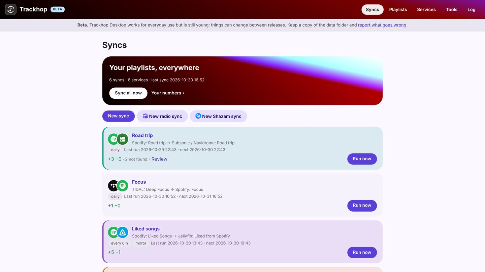
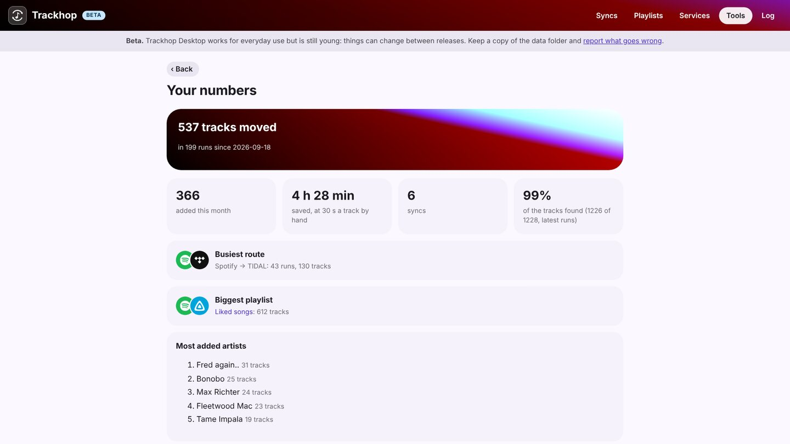

# Playlist sync for Linux

**Trackhop Desktop** keeps your playlists identical across music services on Linux: Spotify,
YouTube and TIDAL (with your own free developer key), your Navidrome, Jellyfin or Plex server,
Last.fm and ListenBrainz, and playlist files. It runs your syncs on a schedule, with an icon in the
tray and its own window. Free and open source (GPL-3.0), no account, its own Java runtime included.

## Install

From the [download table](desktop#install):

| Package | How |
|---|---|
| `.deb` (Debian, Ubuntu, Mint, Pop!_OS…) | `sudo apt install ./Trackhop-Desktop-v…-linux.deb`, then *Trackhop* in the menu |
| Flatpak (any distribution) | `flatpak install --user Trackhop-Desktop-v…-linux.flatpak` (built from source, as Flathub does) |
| `.tar.gz` (any x86-64 distribution) | unpack and run `Trackhop/bin/Trackhop` |

On a server or a NAS with no desktop, use **Docker** instead: one container, a web page, the syncs
around the clock ([how](playlist-sync-nas)).

## What you can do

- **Sync playlists on a schedule**, hourly to weekly, additions only or removals mirrored too.
- **Transfer many playlists at once**, liked songs and saved albums included.
- **Review** the tracks the target does not have, with suggested replacements.
- **Back up** every playlist as dated files (CSV, M3U, XSPF, JSPF…), on a schedule.
- **Radio syncs**: the songs an internet radio plays in the hours you choose, saved to a playlist.
- **Automate it**: cron or systemd timers with the [command line](cli)
  (`trackhop-cli run --all --wait`), or the [REST API and webhook](docker#api).

Its pages are served only to this computer (127.0.0.1). Your data stays in
`~/.local/share/trackhop` (`~/.var/app/io.github.xlollx.Trackhop/data/trackhop` with the Flatpak).

More: [the Desktop guide](desktop) · [Windows](playlist-sync-windows) · [Mac](playlist-sync-mac) ·
[self-hosted](self-hosted-playlist-sync)

[All guide pages](./)
