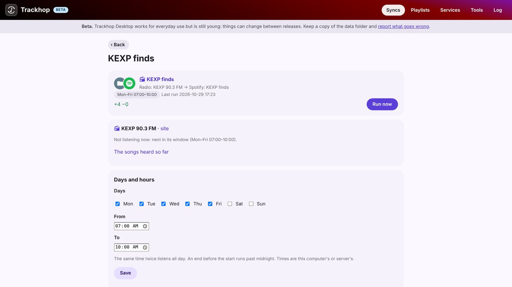

# Playlist sync for Mac

**Trackhop Desktop** keeps your playlists identical across music services from a Mac, Apple silicon
or Intel, macOS 11 or later: Spotify, YouTube and TIDAL (with your own free developer key), your
Navidrome, Jellyfin or Plex server, Last.fm and ListenBrainz, and playlist files. It lives in the
menu bar and runs your syncs on a schedule while the Mac is on. Free and open source, no account.


## Install

With [Homebrew](https://brew.sh):

```sh
brew install --cask xlollx/tap/trackhop
```

Or download the `.dmg` from the [download table](desktop#install) (`arm64` for Apple silicon, `x64`
for Intel), open it and drag Trackhop into *Applications*.

**The first time, macOS refuses to open it**: Trackhop is not signed with Apple's paid developer
certificate, as is usual for free open-source apps. Once: *System Settings › Privacy & Security*,
"Trackhop was blocked…", **Open Anyway**. From then on it opens normally.
[More](desktop#macos).

## What you can do

- **Sync playlists on a schedule**, hourly to weekly, additions only or removals mirrored too.
- **Transfer many playlists at once**, liked songs and saved albums included.
- **Review** the tracks the target does not have, with suggested replacements.
- **Back up** every playlist as dated files, and the whole set-up in one file.
- **Radio syncs**: the songs an internet radio plays in the hours you choose, saved to a playlist.
- **Automate it** with the [command line](cli) (`trackhop run --all`, also `trackhop` after the
  Homebrew install) or the [REST API](docker#api).



On the Mac its pages open in your browser, at an address only this Mac can reach. Your data stays
in `~/Library/Application Support/Trackhop`.

More: [the Desktop guide](desktop) · [Windows](playlist-sync-windows) · [Linux](playlist-sync-linux)
· [on a home server](playlist-sync-nas)

[All guide pages](./)
