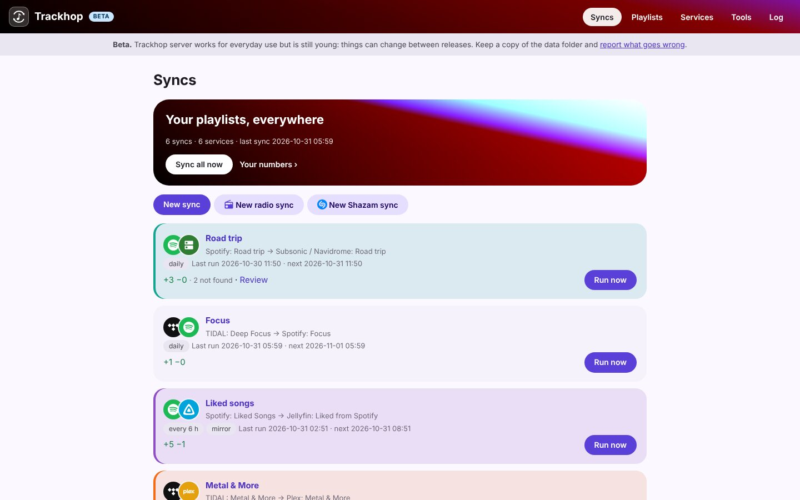
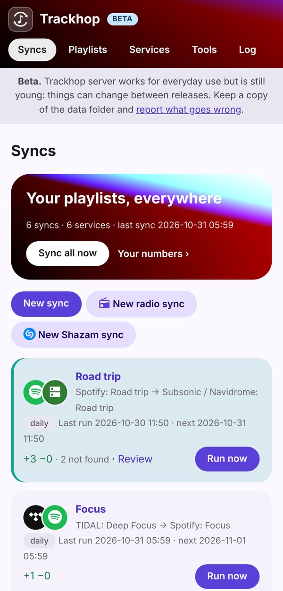

# Playlist sync on a NAS or home server

A NAS or a small home server is on all the time: the best place for playlist syncs. Trackhop's
Docker image runs on **Synology**, **Unraid**, **TrueNAS SCALE**, **OpenMediaVault**, a **Raspberry Pi**
4 or 5 and any machine with Docker, `amd64` or `arm64`. It keeps your playlists identical between
streaming services and your own Navidrome, Jellyfin or Plex, with a web page to manage it, also from
your phone.



## The container

| Setting | Value |
|---|---|
| Image | `ghcr.io/xlollx/trackhop:latest` (also `xlollx/trackhop` on Docker Hub) |
| Port | `8080` (the web page) |
| Volume | a folder of yours → `/data` (syncs, sign-ins, backups) |
| Environment | `SONGPORT_PASSWORD` (the page's password), `SONGPORT_URL` (the address you open it at), optional `SONGPORT_LOCALE` (`it`, `de`…) |

With Docker Compose (Portainer stacks, Unraid's Compose plugin, TrueNAS custom apps):

```yaml
services:
  trackhop:
    image: ghcr.io/xlollx/trackhop:latest
    container_name: trackhop
    restart: unless-stopped
    ports:
      - "8080:8080"
    volumes:
      - ./trackhop-data:/data
    environment:
      SONGPORT_URL: http://192.168.1.10:8080
      SONGPORT_PASSWORD: choose-one
```

`192.168.1.10` is only an example: in `SONGPORT_URL` put your NAS's own address on your network
(on a Synology: *Control Panel › Network › Network Interface*), with the port. Sign-ins to the music
services come back to that address, so a wrong one makes them fail.

When the page asks for a user name and a password, any user name works: only the password counts,
the one in `SONGPORT_PASSWORD`.

## Per system

- **Synology** (DSM 7.2 and later): *Container Manager › Project › Create*, paste the Compose file
  above, choose a folder for the data.
- **Unraid**: *Docker › Add Container*: repository `ghcr.io/xlollx/trackhop`, port 8080, a path
  `/mnt/user/appdata/trackhop` → `/data`, the variables above. Or the Compose plugin.
- **TrueNAS SCALE**: *Apps › Discover Apps › Custom App*, the same image, port, storage and variables.
- **Raspberry Pi**: 64-bit Raspberry Pi OS, install Docker, then the `docker run` command of the
  [Docker guide](docker#start-it).

## Then

1. Open `http://<nas>:8080` and sign in with your password.
2. **Services**: add Navidrome, Jellyfin or Plex (address and login) and your streaming service.
3. **New sync**: source, target, how often. Done: it runs by itself from now on.
4. On your phone, add the page to the home screen: it opens [like an app](docker#on-your-phone-as-an-app).



To update: pull the new image and recreate the container; the data stays in its folder. Everything
else (each service, the API, backups, radio syncs): the [Docker guide](docker).

[All guide pages](./) · [Self-hosted playlist sync](self-hosted-playlist-sync)
