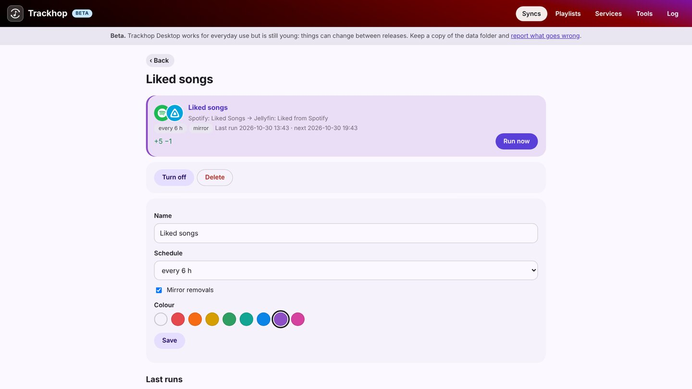

# Playlist sync for Windows

**Trackhop Desktop** keeps your playlists identical across music services from a Windows 10 or 11
PC: Spotify, YouTube and TIDAL (with your own free developer key), your Navidrome, Jellyfin or Plex
server, Last.fm and ListenBrainz, and playlist files. It sits next to the clock and runs your syncs
on a schedule while the computer is on. Free and open source, no account, nothing to install besides
it (no Java, no Docker, no administrator rights).

## Install

| How | Details |
|---|---|
| Installer (.msi) | From the [download table](desktop#install): installs for your user only, with a Start menu entry. |
| Portable (.zip) | Unzip anywhere, even a USB stick, and run `Trackhop.exe`. |
| [Scoop](https://scoop.sh) | `scoop bucket add xlollx https://github.com/xlollx/scoop-bucket` then `scoop install xlollx/trackhop` |
| winget, Chocolatey, Microsoft Store | On their way ([status](desktop#install)). |

Windows may say "Windows protected your PC" the first time: the installer is not signed with a paid
certificate. Choose *More info*, then *Run anyway*.

## What you can do

- **Sync playlists on a schedule**, hourly to weekly, additions only or removals mirrored too.
- **Transfer many playlists at once**, liked songs and saved albums included.
- **Review** the tracks the target does not have, with suggested replacements.
- **Back up** every playlist as dated files, and the whole set-up in one file.
- **Radio syncs**: the songs an internet radio plays in the hours you choose, saved to a playlist.
- **Automate it**: Task Scheduler with the [command line](cli) (`trackhop run --all`), or the
  [REST API](docker#api).

Its pages are served only to this computer (127.0.0.1). Your data stays in `%APPDATA%\Trackhop`.

More: [the Desktop guide](desktop) · [Mac](playlist-sync-mac) · [Linux](playlist-sync-linux) ·
[on a home server](playlist-sync-nas)

[All guide pages](./)
