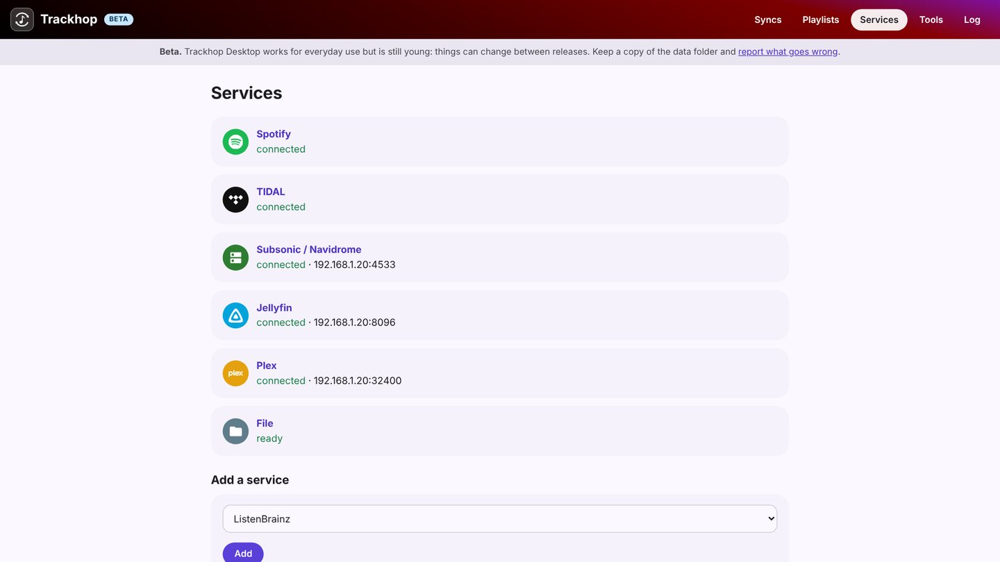

# Self-hosted playlist sync

You run your own music server, **Navidrome** (or another Subsonic server), **Jellyfin** or **Plex**,
and you still have playlists on a streaming service. Trackhop keeps the two in step: the same
playlists on both sides, updated on a schedule, on hardware you own. No account, no cloud service
in the middle, free and open source.


## What it does

- **Streaming → your server**: a Spotify, YouTube Music, TIDAL or Deezer playlist (or your liked
  songs; Apple Music too, from the Android app) becomes a playlist on Navidrome, Jellyfin or Plex,
  matched against **your own library** by ISRC, then title, artists and duration. Songs you do not
  own are listed, not faked.
- **Your server → streaming**: the playlists you build at home, on the go too.
- **Server ↔ server**: moving from Plex to Jellyfin, or keeping both.
- **On a schedule**: hourly, every 6 hours, daily or weekly; additions only, or removals mirrored as
  well, with a safety check before a large deletion.
- **Backups**: every playlist as dated files (CSV, M3U and more), on a schedule.

## Where it runs

| Where | What you get |
|---|---|
| **[Docker](docker)** on a home server, a NAS or a Raspberry Pi | The syncs run around the clock; a web page to set them up, also as an app on your phone. [On a NAS](playlist-sync-nas). |
| **[Trackhop Desktop](desktop)** on [Windows](playlist-sync-windows), [macOS](playlist-sync-mac) or [Linux](playlist-sync-linux) | The same engine as a program, while the computer is on. |
| **The Android app** | On your phone, talking to your server directly. |

Start it with Docker in one command:

```sh
docker run -d --name trackhop -p 8080:8080 -v trackhop-data:/data \
  -e SONGPORT_PASSWORD=choose-one ghcr.io/xlollx/trackhop:latest
```

Then open `http://<server>:8080`, add your music server under **Services** (its address and your
login) and a streaming service, and create a sync. The [Docker guide](docker) has Compose, the
settings and the details for each service.



## Why self-host it

- **Your logins stay with you**: nothing goes through a third-party service.
- **No limits and no subscription**: as many playlists and tracks as you like.
- **It talks to your server on your network**: no need to open it to the internet.
- **Scriptable**: a [REST API, a webhook](docker#api) and a [command line](cli), for Home Assistant,
  n8n or cron.

Step by step: [Spotify to Navidrome, Jellyfin or Plex](spotify-to-navidrome-jellyfin).

[All guide pages](./)
